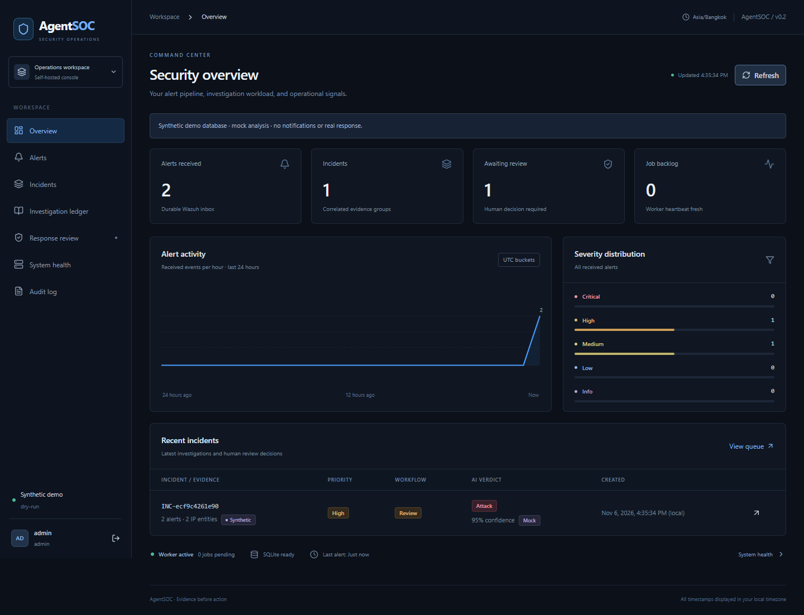
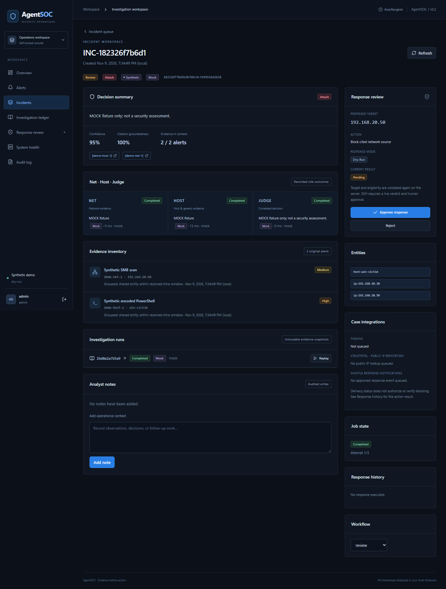
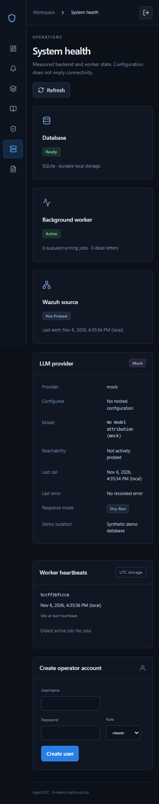
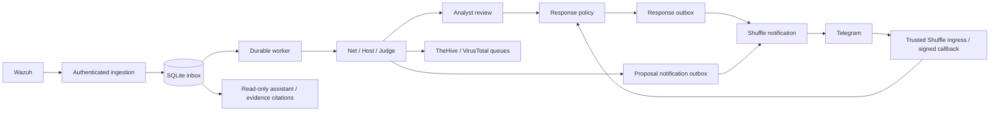

<h1 align="center">AgentSOC</h1>
<p align="center"><strong>Security Operations Workspace</strong><br>Tiếp nhận cảnh báo · Điều tra có bằng chứng · Phản ứng có người duyệt</p>

<p align="center">
  <a href="#quick-start">Chạy local</a> ·
  <a href="#demo">Demo</a> ·
  <a href="#integrations">Tích hợp SOC</a> ·
  <a href="docs/ARCHITECTURE.md">Kiến trúc</a> ·
  <a href="docs/validation-integrations.md">Kiểm thử</a>
</p>

Ứng dụng SOC self-hosted cho chuyên viên vận hành: **Wazuh → inbox bền vững → correlation →
Net/Host/Judge → investigation ledger → human review**. Console React/TypeScript/Tailwind,
FastAPI và worker riêng,dùng SQLite; không mang một hệ microservices nặng sang VPS.

Mặc định **không seed dữ liệu**, `LLM_MODE=mock`, `RESPONSE_MODE=dry-run`. Mock được gắn nhãn,
không phải đánh giá an ninh thật. Không tự tải model, sửa Wazuh/VPN/firewall hay triển khai VPS.

## Giao diện

Ảnh chụp từ ứng dụng chạy local với database demo cách ly: dữ liệu synthetic được gửi qua
HTTP ingestion, worker xử lý bằng mock AI và response ở chế độ dry-run. Các số liệu trong ảnh
minh họa luồng vận hành, không phải kết quả đánh giá phát hiện trên hệ thống thật.



<details>
<summary><strong>Investigation workspace — bằng chứng, Net / Host / Judge và response review</strong></summary>



</details>

<details>
<summary><strong>Mobile — System health và External integrations</strong></summary>



</details>

## Chức năng

- Overview: global aggregates, time series alert thật theo received time và backlog.
- Alerts: filter/pagination phía server, normalized envelope, JSON gốc và liên kết incident.
- Incidents/detail: workflow riêng, evidence inventory, entity, run timeline, Net/Host/Judge, notes.
- Investigation ledger: guarded input, structured output, tool/citations, attempts, usage và error.
- Web AI Assistant: rà soát incident gần đây, giải thích verdict/đề xuất và dẫn nguồn evidence có liên kết
  tới alert/incident. Phân biệt dữ kiện đã lưu với nhận định AI; nêu rõ bằng chứng thiếu hoặc model không khả dụng.
- Giao diện **EN | VI**: đổi ngôn ngữ ngay, lưu lựa chọn qua các phiên; mặc định English cho người dùng mới.
- Response review: eligibility phía server, approve/reject và lịch sử; không nhận target do UI chọn.
- Web/Telegram dùng chung proposal theo analysis run, trạng thái quyết định, kiểm tra quyền và audit;
  proposal hết hạn hoặc stale không được thực thi, request trùng không tạo thêm response action.
- System health: DB, worker heartbeat, job age/dead letters, last alert và provider attribution.
- Audit: actor, operation, target, time và result. UTC ở storage, timezone rõ trên giao diện.

Không có graph, threat-intel hay ATT&CK coverage giả. Null/No data nghĩa là chưa có số đo.
Provider configured không có nghĩa reachable; Wazuh không được gọi connected chỉ vì API đang chạy.

### Phạm vi triển khai và xác minh

| Phạm vi | Trạng thái |
| --- | --- |
| **Đã có trong source** | Assistant chỉ đọc với evidence citations; EN/VI; Telegram commands/inline buttons qua Shuffle; approval chung; notification outbox, retry và danh sách nhiều chat, gồm cấu hình hai chat. |
| **Đã kiểm thử bằng mocks hoặc CI cách ly** | Quyền/HMAC/replay/race, hai notification recipients, Web/Telegram cùng trạng thái, dry-run; container Python 3.12, Backend/Worker cùng image, health, migration v2 và rollback bằng image cũ trên bản sao DB. Đây không phải live SOC E2E. |
| **Cần xác minh live VPS/Shuffle/Telegram** | Image/configuration thực tế, WireGuard/Wazuh, provider live, TheHive/VirusTotal và workflow/bot thật; xác thực ingress, operator mapping, hai chat và durable delivery ledger phải được cấu hình, kiểm tra tại lab. |
| **Kế hoạch tương lai** | pfSense live adapter, apply/verify block, tự gỡ sau 24 giờ và rollback firewall. Hiện chỉ có interface, kiểm tra kế hoạch và tài liệu thiết kế; **không có live pfSense blocking**. |

Assistant truy xuất evidence Wazuh **đã ingest vào AgentSOC**, không truy vấn Wazuh manager trực tiếp.
Endpoint hội thoại không có quyền approve/reject, chạy shell hay thực thi mitigation; mọi quyết định
đi qua review có cấu trúc. LLM lỗi không làm mất dữ kiện trả về hoặc thay đổi luồng ingestion/worker.
Xem [báo cáo nâng cấp AI Assistant](docs/UPGRADE_AI_ASSISTANT.md) và
[deployment readiness, validation và rollback](docs/DEPLOYMENT_READINESS.md).



## Quick start

Cần Python 3.12+ và Node.js 22.12+. Mở đúng folder AgentSOC:

```powershell
git clone https://github.com/boi1707/AgentSOC.git
cd AgentSOC
python -m venv .venv
.\.venv\Scripts\python.exe -m pip install -r requirements-dev.lock
.\.venv\Scripts\python.exe -m scripts.dev --build
```

Mở **http://127.0.0.1:8000/console**. Launcher tạo `.env` nếu thiếu, sinh hai key ứng dụng
khác nhau khi trống, build console rồi chạy API + worker tách process. Không in key ra log.
Đăng nhập `ADMIN_USERNAME` (mặc định `admin`) bằng `ADMIN_PASSWORD`, hoặc `APPROVE_KEY` trong
`.env` khi admin password để trống. Bootstrap chỉ chạy nếu chưa có users.

`ADMIN_PASSWORD` nếu được đặt phải có ít nhất 24 ký tự. Thay đổi biến này không đổi mật khẩu
của tài khoản đã tồn tại trong database. `.env`, database, phiên đăng nhập và mật khẩu local
không được đưa lên Git; bản clone mới không có sẵn tài khoản hay mật khẩu dùng chung.

VS Code: **Tasks → Run Task → AgentSOC: local application**. Có task riêng cho demo và backend tests.
Đã clone repo thì bỏ qua hai lệnh đầu. Chạy Linux tương đương với `.venv/bin/python`.
Docker, local development và tham chiếu API: [Operations](docs/OPERATIONS.md).

## Demo

```powershell
.\.venv\Scripts\python.exe -m scripts.dev --demo --build
# Terminal khác, gửi fixture qua ingestion thật:
.\.venv\Scripts\python.exe -m scripts.replay datasets/demo.jsonl --url http://127.0.0.1:8001 --fresh
```

Mở **http://127.0.0.1:8001/console**. Demo dùng `data/demo/agentsoc.db` (hoặc DEMO_DB), không dùng DB
production; lưu cờ synthetic ở alert/case và hiển thị trong UI. Demo bắt buộc mock/dry-run, tắt
Telegram, không SSH. Không seed trực tiếp case/verdict: fixture đi qua inbox, worker, tools và agents.
`--fresh` chỉ dùng demo lại; không dùng khi đối chiếu nhãn dựa trên ID cũ.

## Integrations

Đã có các tích hợp tùy chọn, mặc định tắt:

| Dịch vụ | Vai trò | Cơ chế |
| --- | --- | --- |
| **TheHive** | Mirror case, verdict, evidence IDs và kết quả response | Queue SQLite, remote ID, đối soát tag và checkpoint cho POST chưa rõ kết quả. |
| **VirusTotal** | Reputation bổ sung sau điều tra | Tối đa 3 public IP/incident, cache 24 giờ, quota bền vững; không tự sửa verdict/confidence. |
| **Shuffle** | Thông báo proposal và kết quả Approve/Ignore; chuyển tiếp Telegram callback | Hai outbox SQLite, event ID và recipient snapshot cố định, lease/backoff/dead-letter; AgentSOC giữ quyền quyết định. |
| **Telegram qua Shuffle** | Queries, Approve/Ignore buttons và commands cho operator được phép | HMAC callback, mapping Telegram user → local account/role; notification chat không tự có quyền approve. Hỗ trợ hai chat hoặc danh sách nhiều recipients. |

Approve vẫn ở AgentSOC. Chế độ demo không gọi các dịch vụ ngoài. Trang incident và System health
hiển thị trạng thái queue/kết quả; cấu hình không đồng nghĩa kết nối đã được xác minh.
Xem [hướng dẫn tích hợp và triển khai](docs/integrations.vi.md), [.env.example](.env.example)
và [chi tiết TheHive](docs/thehive.md). Không đưa key thật hoặc URL webhook vào Git.

Kết quả kiểm tra patch và giới hạn build/browser local được ghi riêng trong
[validation-integrations.md](docs/validation-integrations.md); chưa xác minh tích hợp trên VPS.

### Telegram commands và approval an toàn

Sau khi cấu hình trusted ingress và bot/workflow theo
[hướng dẫn Shuffle từng node](integrations/shuffle/WORKFLOWS.md), operator có thể dùng:

```text
/status
/incidents
/pending
/review 24h
/incident <incident_id>
/why <incident_id>
/approve <incident_id> <proposal_id>
/ignore <incident_id> <proposal_id>
```

Inline Approve/Ignore buttons tham chiếu analysis-run ID; AgentSOC xác minh người gửi, local role,
run hiện tại, expiry, evidence và protected IP trước khi claim quyết định atomically. Shuffle phải
xác thực webhook Telegram trước khi ký callback HMAC; không tin user ID từ HTTP payload chưa xác thực.
`TELEGRAM_USERS` là mapping operator; `TELEGRAM_NOTIFY_CHATS` là danh sách nhận thông báo độc lập.
Không đưa bot token hoặc signing secret vào URL/button. Các workflow vẫn cần cài đặt/cấu hình thủ công;
không tuyên bố đã import hay chạy workflow thật chỉ vì có helper/template trong repo.

Mỗi action tạo một logical result event; retry notification không chạy lại mitigation. Receiver cần
dedupe theo `(event_id, chat_id)` và giữ trạng thái bền vững. Telegram vẫn có thể nhận trùng một tin
nhắn vật lý khi mất acknowledgement; không cam kết exactly-once physical delivery.

## Phân quyền và response

| Role | Quyền |
| --- | --- |
| viewer | Đọc console/evidence/ledger |
| analyst | Viewer + notes, workflow và replay |
| approver | Analyst + approve/reject response |
| admin | Approver + tạo operator qua System health/API |

Session cookie HttpOnly/SameSite=Strict, CSRF token ở memory; không lưu credential trong localStorage.
Khi dùng HTTPS đặt `SESSION_COOKIE_SECURE=1`. Dùng localhost/VPN hoặc HTTPS, không public HTTP reviewer.
Client legacy HTTP Basic `reviewer`/APPROVE_KEY vẫn có qua `/cases`; đây là credential compatibility
có quyền duyệt, không cấp cho viewer/analyst. Mỗi operator nên có tài khoản riêng.

Mọi response vẫn cần người duyệt. Server kiểm tra lại attack/confidence/groundedness, IP nguồn từ
network evidence được cite, protected networks và mode. Mock/synthetic không được SSH. Intent/actor
được lưu trước executor; approve lặp không thực thi lại. Crash/timeout mơ hồ là action_unknown, không
retry SSH. `blocked` chưa có nghĩa đã verification nftables: verification_status vẫn not_verified.

Trong **`RESPONSE_MODE=dry-run`**, approval được lưu cùng kết quả mô phỏng `status=dry_run`,
`blocked=false`, `verification_status=not_verified`; không gọi SSH hay sửa firewall. Compose chính
giữ dry-run cho cả Backend/Worker. `LLM_MODE=live` chỉ cho phép phân tích, không cấp quyền blocking.
`PfSenseAdapter` hiện chỉ kiểm tra block plan và từ chối `block/remove`; không có live transport hoặc
chế độ pfSense có thể bật. Thiết kế TTL 24 giờ chưa phải worker gỡ block đang hoạt động.

## Kiểm thử và vận hành

Kết quả đã đối chiếu với **main `c400e704a3733de0fb7c82aa2aa1139d4d356117`**, merge PR #4,
ngày 17/11/2026: [GitHub Actions run 44102987963](https://github.com/boi1707/AgentSOC/actions/runs/44102987963).
[Workflow `Backend checks`](https://github.com/boi1707/AgentSOC/actions/workflows/tests.yml)
chạy trên push và pull request; cấu hình tại [`.github/workflows/tests.yml`](.github/workflows/tests.yml).

| Kiểm tra Ubuntu CI trên commit main đã xác minh | Kết quả |
| --- | --- |
| Backend pytest — Python 3.12 | **193 passed, 1 skipped** |
| Backend pytest — Python 3.14 | **193 passed, 1 skipped** |
| Ruff check / format, replay và shell syntax | **PASS** trên cả hai Python jobs |
| Frontend typecheck / lint / production build | **PASS** |
| Browser E2E — Playwright Chromium, desktop/mobile, EN/VI và assistant | **3 passed** |
| Docker Python 3.12 image và rollback gate | **PASS — 13/13 stages**, gồm health, session/CSRF, dry-run, migration/backup và actual historical image |

Docker kiểm tra API từ localhost **bên trong container**, giữ mạng `--internal` và không publish
cổng cho Backend/Worker của bài kiểm tra chính. Hai service dùng cùng image ID/revision.
[Artifact `docker-validation-result`](https://github.com/boi1707/AgentSOC/actions/runs/44102987963/artifacts/14335789252)
ghi các stage PASS, image revision và kết quả runtime. Migration v2 thêm `callback_receipts` và
`notification_outbox`; kiểm tra bảo toàn dữ liệu, idempotency, lỗi/gián đoạn migration và online
backup/restore được thực hiện trên DB dùng một lần. Image cũ `0022d28` chạy với **bản sao** DB đã migrate;
không suy ra mọi image đang chạy trên VPS đều tương thích. Image rollback không phải database rollback.

Một test live-provider vẫn được skip theo mặc định; không có paid model request trong CI này.
Mocks kiểm tra Shuffle/Telegram, TheHive/VirusTotal và callback security; CI container dùng mock LLM
và external integrations tắt. Các kết quả này không chứng minh workflow Telegram hay production E2E đã đạt.

<details>
<summary><strong>Lệnh chạy kiểm tra</strong></summary>

```powershell
.\.venv\Scripts\python.exe -m pytest -q
.\.venv\Scripts\python.exe -m ruff check src scripts tests integrations
.\.venv\Scripts\python.exe -m ruff format --check src scripts tests integrations
# Trong frontend:
npm run typecheck
npm run lint
npm run build
npm run test:e2e
```

</details>

Browser test dùng Chrome có sẵn trên Windows hoặc Playwright Chromium; Linux chạy
`npx playwright install --with-deps chromium` trong frontend trước browser test.
Test tạo DB riêng, đi qua HTTP thật, worker process riêng và SQLite thật, nhưng dùng mock AI/dry-run;
không gửi Telegram, chạy SSH thật hoặc tiêu tiền cloud API. Live integration chưa được bật tự động.
## Tài liệu và giới hạn

- [Nâng cấp AI Assistant, EN/VI, approval và security design](docs/UPGRADE_AI_ASSISTANT.md)
- [Deployment readiness, CI evidence, migration và rollback runbook](docs/DEPLOYMENT_READINESS.md)
- [Shuffle/Telegram: hướng dẫn workflow từng node, trust và delivery](integrations/shuffle/WORKFLOWS.md)
- [Vận hành, Docker, local development, API và cấu hình](docs/OPERATIONS.md)
- [Tích hợp TheHive, Shuffle, VirusTotal](docs/integrations.vi.md)
- [Kết quả kiểm thử tích hợp và phạm vi xác minh](docs/validation-integrations.md)
- [Kiến trúc và trạng thái](docs/ARCHITECTURE.md)
- [Khảo sát AgentSOC/AiSOC, SHA và license](docs/ARCHITECTURE_COMPARISON.md)
- [Triển khai cùng hạ tầng hiện hữu](docs/DEPLOYMENT.md)
- [Migration, backup, rollback và tương thích](docs/UPGRADE.md)
- [Phạm vi nghiệm thu](docs/IMPLEMENTATION.md)
- [Kết quả kiểm thử local và các mục chưa xác minh](docs/VALIDATION.md)

Chưa đo RAM/CPU/throughput được trên VPS đang chạy Wazuh, độ chính xác bằng nhãn thật hay chi phí model
thật. Không dùng số mock làm số liệu đồ án. SQLite hiện dành cho một workspace; chưa SSO,
multi-tenant hoặc audit chống sửa. Shuffle có durable notification outbox; Telegram trực tiếp chưa
có spool/retry. Docker đã được xác minh trong CI cách ly; kết nối VPS/Wazuh/LLM live/Telegram thật
vẫn cần kiểm tra ở môi trường tương ứng. pfSense live blocking chỉ là kế hoạch, không phải chức năng
đã triển khai. Không bật SSH/pfSense hoặc deploy VPS tự động; không publish datastore.
License của dependencies được giữ tại `/THIRD_PARTY_NOTICES.txt` trong console build.
