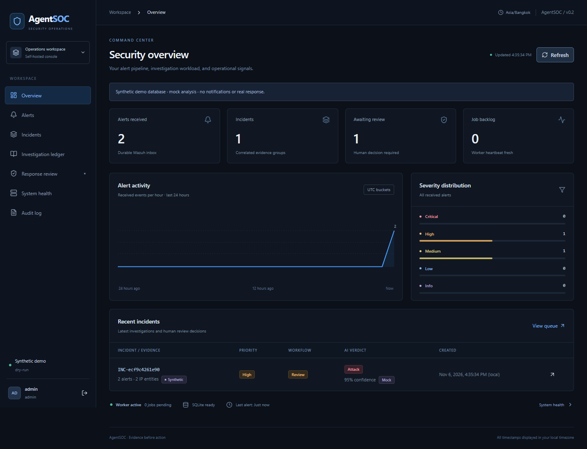
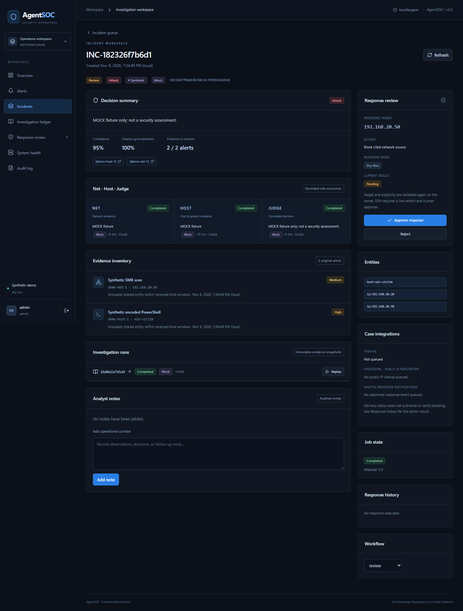
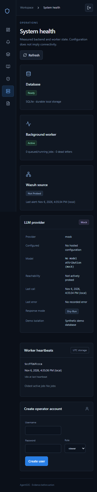
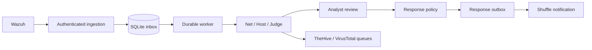

<h1 align="center">AgentSOC</h1>
<p align="center"><strong>Security Operations Workspace</strong><br>Tiếp nhận cảnh báo · Điều tra có bằng chứng · Phản ứng có người duyệt</p>

<p align="center">
  <a href="#quick-start">Chạy local</a> ·
  <a href="#demo">Demo</a> ·
  <a href="#integrations">Tích hợp SOC</a> ·
  <a href="docs/ARCHITECTURE.md">Kiến trúc</a> ·
  <a href="docs/validation-integrations.md">Kiểm thử</a>
</p>

Ứng dụng SOC self-hosted cho chuyên viên vận hành: **Wazuh → inbox bền vững → correlation →
Net/Host/Judge → investigation ledger → human review**. Console React/TypeScript/Tailwind,
FastAPI và worker riêng,dùng SQLite; không mang một hệ microservices nặng sang VPS.

Mặc định **không seed dữ liệu**, `LLM_MODE=mock`, `RESPONSE_MODE=dry-run`. Mock được gắn nhãn,
không phải đánh giá an ninh thật. Không tự tải model, sửa Wazuh/VPN/firewall hay triển khai VPS.

## Giao diện

Ảnh chụp từ ứng dụng chạy local với database demo cách ly: dữ liệu synthetic được gửi qua
HTTP ingestion, worker xử lý bằng mock AI và response ở chế độ dry-run. Các số liệu trong ảnh
minh họa luồng vận hành, không phải kết quả đánh giá phát hiện trên hệ thống thật.



<details>
<summary><strong>Investigation workspace — bằng chứng, Net / Host / Judge và response review</strong></summary>



</details>

<details>
<summary><strong>Mobile — System health và External integrations</strong></summary>



</details>

## Chức năng

- Overview: global aggregates, time series alert thật theo received time và backlog.
- Alerts: filter/pagination phía server, normalized envelope, JSON gốc và liên kết incident.
- Incidents/detail: workflow riêng, evidence inventory, entity, run timeline, Net/Host/Judge, notes.
- Investigation ledger: guarded input, structured output, tool/citations, attempts, usage và error.
- Response review: eligibility phía server, approve/reject và lịch sử; không nhận target do UI chọn.
- System health: DB, worker heartbeat, job age/dead letters, last alert và provider attribution.
- Audit: actor, operation, target, time và result. UTC ở storage, timezone rõ trên giao diện.

Không có graph, threat-intel hay ATT&CK coverage giả. Null/No data nghĩa là chưa có số đo.
Provider configured không có nghĩa reachable; Wazuh không được gọi connected chỉ vì API đang chạy.



## Quick start

Cần Python 3.12+ và Node.js 22.12+. Mở đúng folder AgentSOC:

```powershell
git clone https://github.com/boi1707/AgentSOC.git
cd AgentSOC
python -m venv .venv
.\.venv\Scripts\python.exe -m pip install -r requirements-dev.lock
.\.venv\Scripts\python.exe -m scripts.dev --build
```

Mở **http://127.0.0.1:8000/console**. Launcher tạo `.env` nếu thiếu, sinh hai key ứng dụng
khác nhau khi trống, build console rồi chạy API + worker tách process. Không in key ra log.
Đăng nhập `ADMIN_USERNAME` (mặc định `admin`) bằng `ADMIN_PASSWORD`, hoặc `APPROVE_KEY` trong
`.env` khi admin password để trống. Bootstrap chỉ chạy nếu chưa có users.

`ADMIN_PASSWORD` nếu được đặt phải có ít nhất 24 ký tự. Thay đổi biến này không đổi mật khẩu
của tài khoản đã tồn tại trong database. `.env`, database, phiên đăng nhập và mật khẩu local
không được đưa lên Git; bản clone mới không có sẵn tài khoản hay mật khẩu dùng chung.

VS Code: **Tasks → Run Task → AgentSOC: local application**. Có task riêng cho demo và backend tests.
Đã clone repo thì bỏ qua hai lệnh đầu. Chạy Linux tương đương với `.venv/bin/python`.
Docker, local development và tham chiếu API: [Operations](docs/OPERATIONS.md).

## Demo

```powershell
.\.venv\Scripts\python.exe -m scripts.dev --demo --build
# Terminal khác, gửi fixture qua ingestion thật:
.\.venv\Scripts\python.exe -m scripts.replay datasets/demo.jsonl --url http://127.0.0.1:8001 --fresh
```

Mở **http://127.0.0.1:8001/console**. Demo dùng `data/demo/agentsoc.db` (hoặc DEMO_DB), không dùng DB
production; lưu cờ synthetic ở alert/case và hiển thị trong UI. Demo bắt buộc mock/dry-run, tắt
Telegram, không SSH. Không seed trực tiếp case/verdict: fixture đi qua inbox, worker, tools và agents.
`--fresh` chỉ dùng demo lại; không dùng khi đối chiếu nhãn dựa trên ID cũ.

## Integrations

Đã có các tích hợp tùy chọn, mặc định tắt:

| Dịch vụ | Vai trò | Cơ chế |
| --- | --- | --- |
| **TheHive** | Mirror case, verdict, evidence IDs và kết quả response | Queue SQLite, remote ID, đối soát tag và checkpoint cho POST chưa rõ kết quả. |
| **VirusTotal** | Reputation bổ sung sau điều tra | Tối đa 3 public IP/incident, cache 24 giờ, quota bền vững; không tự sửa verdict/confidence. |
| **Shuffle** | Thông báo sau Approve có kết quả | Outbox/retry với event ID cố định; receiver phải dedupe, không chặn IP lần hai. |

Approve vẫn ở AgentSOC. Chế độ demo không gọi các dịch vụ ngoài. Trang incident và System health
hiển thị trạng thái queue/kết quả; cấu hình không đồng nghĩa kết nối đã được xác minh.
Xem [hướng dẫn tích hợp và triển khai](docs/integrations.vi.md), [.env.example](.env.example)
và [chi tiết TheHive](docs/thehive.md). Không đưa key thật hoặc URL webhook vào Git.

Kết quả kiểm tra patch và giới hạn build/browser local được ghi riêng trong
[validation-integrations.md](docs/validation-integrations.md); chưa xác minh tích hợp trên VPS.

## Phân quyền và response

| Role | Quyền |
| --- | --- |
| viewer | Đọc console/evidence/ledger |
| analyst | Viewer + notes, workflow và replay |
| approver | Analyst + approve/reject response |
| admin | Approver + tạo operator qua System health/API |

Session cookie HttpOnly/SameSite=Strict, CSRF token ở memory; không lưu credential trong localStorage.
Khi dùng HTTPS đặt `SESSION_COOKIE_SECURE=1`. Dùng localhost/VPN hoặc HTTPS, không public HTTP reviewer.
Client legacy HTTP Basic `reviewer`/APPROVE_KEY vẫn có qua `/cases`; đây là credential compatibility
có quyền duyệt, không cấp cho viewer/analyst. Mỗi operator nên có tài khoản riêng.

Mọi response vẫn cần người duyệt. Server kiểm tra lại attack/confidence/groundedness, IP nguồn từ
network evidence được cite, protected networks và mode. Mock/synthetic không được SSH. Intent/actor
được lưu trước executor; approve lặp không thực thi lại. Crash/timeout mơ hồ là action_unknown, không
retry SSH. `blocked` chưa có nghĩa đã verification nftables: verification_status vẫn not_verified.

## Kiểm thử và vận hành

| Kiểm tra local ngày 09/11/2026 | Kết quả |
| --- | --- |
| Backend pytest | **142 passed, 1 skipped** |
| Ruff check / format | Đạt |
| Frontend typecheck / lint / production build | Đạt |
| Browser E2E — Chrome, desktop và mobile | **2 passed** |
| npm audit | **0 lỗ hổng được báo cáo** |

<details>
<summary><strong>Lệnh chạy kiểm tra</strong></summary>

```powershell
.\.venv\Scripts\python.exe -m pytest -q
.\.venv\Scripts\python.exe -m ruff check src scripts tests
.\.venv\Scripts\python.exe -m ruff format --check src scripts tests
# Trong frontend:
npm run typecheck
npm run lint
npm run build
npm run test:e2e
```

</details>

Browser test dùng Chrome có sẵn trên Windows hoặc Playwright Chromium; Linux chạy
`npx playwright install --with-deps chromium` trong frontend trước browser test.
Test tạo DB riêng, đi qua HTTP thật, worker process riêng và SQLite thật, nhưng dùng mock AI/dry-run;
không gửi Telegram, chạy SSH thật hoặc tiêu tiền cloud API. Live integration chưa được bật tự động.
## Tài liệu và giới hạn

- [Vận hành, Docker, local development, API và cấu hình](docs/OPERATIONS.md)
- [Tích hợp TheHive, Shuffle, VirusTotal](docs/integrations.vi.md)
- [Kết quả kiểm thử tích hợp và phạm vi xác minh](docs/validation-integrations.md)
- [Kiến trúc và trạng thái](docs/ARCHITECTURE.md)
- [Khảo sát AgentSOC/AiSOC, SHA và license](docs/ARCHITECTURE_COMPARISON.md)
- [Triển khai cùng hạ tầng hiện hữu](docs/DEPLOYMENT.md)
- [Migration, backup, rollback và tương thích](docs/UPGRADE.md)
- [Phạm vi nghiệm thu](docs/IMPLEMENTATION.md)
- [Kết quả kiểm thử local và các mục chưa xác minh](docs/VALIDATION.md)

Chưa đo RAM/CPU/throughput được trên VPS đang chạy Wazuh, độ chính xác bằng nhãn thật hay chi phí model
thật. Không dùng số mock làm số liệu đồ án. SQLite hiện dành cho một workspace; chưa SSO,
multi-tenant hoặc audit chống sửa. Shuffle có durable notification outbox; Telegram trực tiếp chưa
có spool/retry. Docker và kết nối VPS/Wazuh/LLM/
Telegram/SSH chỉ được đánh dấu đạt sau khi chạy ở môi trường tương ứng. Không publish datastore.
License của dependencies được giữ tại `/THIRD_PARTY_NOTICES.txt` trong console build.
