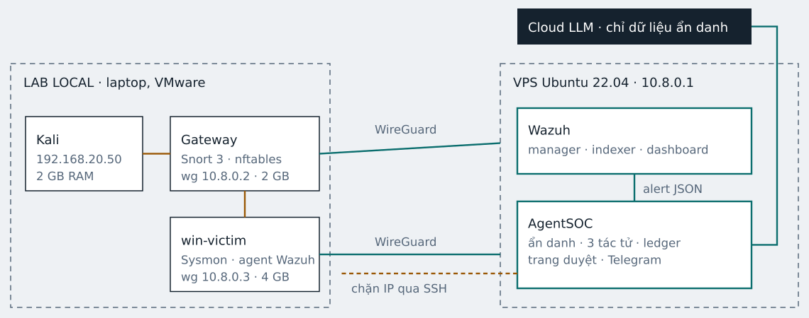

# AgentSOC
An evidence-driven LLM system for security incident analysis and human-reviewed response.

Backend prototype: Wazuh → gom incident → pseudonymization → ba tác tử
network/endpoint/judge → SQLite ledger → người duyệt → dry-run hoặc SSH forced command.

## Kiến trúc



Sơ đồ thiết kế AgentSOC, trích từ tài liệu HTML; không biểu thị hạ tầng đã triển khai thực tế.

## Chạy trên Windows

Yêu cầu Python 3.12+; bản này được kiểm thử local trên Python 3.14.

```powershell
python -m venv .venv
.\.venv\Scripts\python.exe -m pip install -r requirements-dev.lock
Copy-Item .env.example .env
.\.venv\Scripts\python.exe -c "import secrets; print(secrets.token_urlsafe(32)); print(secrets.token_urlsafe(32))"
```

Điền hai chuỗi khác nhau vào `INGEST_KEY` và `APPROVE_KEY` trong `.env`.
Không commit `.env`, database, log thật hoặc khóa SSH.

```powershell
.\.venv\Scripts\python.exe -m uvicorn src.api.main:app --host 127.0.0.1 --port 8000
```

Mở <http://127.0.0.1:8000/cases>, đăng nhập user `reviewer`, password là `APPROVE_KEY`.
Chạy demo từ terminal khác:

```powershell
.\.venv\Scripts\python.exe -m scripts.replay --url http://127.0.0.1:8000 --fresh
```

Alert level ≥12 được xử lý ở vòng worker tiếp theo; alert khác chờ 30 giây im lặng.
Approve ở mặc định `dry-run` chỉ ghi nhận mô phỏng, **không chặn IP thật**.
Mock có thể cố tình trả `attack` cho fixture demo; không phải bằng chứng về khả năng phát hiện.

## Demo offline và kiểm thử

```powershell
.\.venv\Scripts\python.exe -m scripts.replay
.\.venv\Scripts\python.exe -m pytest -q
.\.venv\Scripts\python.exe -m ruff check src scripts tests
.\.venv\Scripts\python.exe -m ruff format --check src scripts tests
.\.venv\Scripts\python.exe -m scripts.metrics --db data/agentsoc.db
```

Demo offline dùng database tạm, không cần `.env`, API key, VPS hay mạng.
Test gồm HTTP thật trên loopback, worker và SQLite thật; Cloud LLM/SSH được giả lập,
không gọi dịch vụ bên ngoài hay tường lửa thật.

## Docker

Tạo `.env` với hai key hợp lệ như trên. Trên VPS Linux:

```bash
mkdir -p data
sudo chown 10001:10001 data
docker compose up -d --build
docker compose ps
make health
make replay
make leaks
```

Mặc định bind localhost; chỉ đặt `BIND_IP=10.8.0.1` sau khi WireGuard đã hoạt động.
Container chạy user UID 10001, filesystem read-only ngoài volume dữ liệu. Chỉ dùng **một
process/replica/worker cho mỗi database**. Không chạy `--workers 2` hoặc hai instance cùng DB.

## API

| Endpoint | Xác thực | Mục đích |
| --- | --- | --- |
| `GET /health` | Không | Kiểm tra DB và chế độ chạy |
| `GET /metrics` | Reviewer | Bộ đếm bền vững, lỗi LLM/guard và thời gian phân tích |
| `POST /ingest` | Bearer `INGEST_KEY` | Nhận alert Wazuh, level ≥7, ID chống trùng |
| `GET /cases` | HTTP Basic `reviewer` / `APPROVE_KEY` | Trang bằng chứng và duyệt |
| `GET /api/cases` | Reviewer | Danh sách case, khôi phục token cục bộ |
| `POST /approve/{id}` | Reviewer + `X-AgentSOC-Review: 1` | Duyệt một lần |
| `POST /reject/{id}` | Reviewer + header như trên | Từ chối một lần |

`/health` trả số case, incident chờ gom/xử lý, alert chưa xử lý, thời điểm nhận alert cuối
(Unix UTC hoặc `null`), chế độ chạy và trạng thái cấu hình LLM; không trả credential.
JSON hỏng trả 400; alert sai schema trả 422; payload lớn hơn 256 KiB trả 413.

HTTP Basic chỉ dùng localhost, tunnel WireGuard hoặc HTTPS; không publish HTTP ra Internet.
Khóa không đi trong query string. Trang review không tải CDN/tài nguyên ngoài.

## LLM và quyền hành động

- Mặc định `LLM_MODE=mock`, `RESPONSE_MODE=dry-run`.
- Live cần `LLM_MODE=live`, `LLM_URL` HTTPS tương thích JSON chat completion,
  `LLM_API_KEY`, `LLM_MODEL`. Chọn model hỗ trợ `response_format=json_object` và temperature 0.
- Luôn pseudonymize cả payload và system prompt; egress guard chạy trước lời gọi mạng.
  Không có tùy chọn tắt ẩn danh trên service đang chạy.
- IP riêng/nonglobal, IPv6, email, mẫu API key, hostname đã cấu hình, user/path được che;
  IPv4 công cộng được giữ để phân tích IOC. Đây là **pseudonymization theo mẫu**, không
  cam kết phát hiện mọi dữ liệu cá nhân trong chuỗi tùy ý. Thêm hostname thật vào `HOST_NAMES`.
- Ledger lưu prompt messages, response, evidence IDs, token usage, thời gian và loại lỗi.
  Giá trị thật và bảng ánh xạ nằm cục bộ trong DB; bảo vệ volume/backup ở cấp hệ điều hành.
- Chặn chỉ hợp lệ nếu attack, confidence ≥ ngưỡng, evidence IDs hợp lệ và IP là **nguồn
  của alert mạng đã được trích dẫn**, không thuộc mạng bảo vệ.
- Mock không được cấu hình SSH. Xem [hướng dẫn triển khai](docs/DEPLOYMENT.md) trước khi bật SSH.

## Trạng thái phạm vi

Đã có backend, SQLite inbox bền vững, ba tác tử, reviewer UI, dry-run, Telegram adapter,
SSH adapter, gateway forced command, Wazuh integration/rules, demo, audit metrics, CI.

Chưa kiểm chứng trên hạ tầng thật: Docker image, Wazuh/Snort/Sysmon, WireGuard, Telegram,
Cloud LLM và nftables end-to-end. Cần VPS/lab, key và thông tin truy cập để hoàn tất phần đó.
Precision/recall, ablation A–D, hiệu quả giảm false positive, chi phí USD và độ trễ mục tiêu
chưa được đo. Không dùng kết quả mock làm số liệu đồ án.

Xem [kế hoạch nghiệm thu](docs/IMPLEMENTATION.md) và [triển khai hạ tầng](docs/DEPLOYMENT.md).

## Setup trên VPS

Trên Ubuntu 22.04 cần Docker Compose v2, `ip`, `ssh-keygen`; nếu dùng script setup còn cần
Python 3.12+ và module venv. Python mặc định của Ubuntu 22.04 là 3.10, nên phải chuẩn bị
Python 3.12 trước hoặc dùng cách Docker thủ công ở trên (container đã có Python 3.12).

```bash
bash scripts/setup.sh
# Script tạo .env nếu chưa có, sinh hai khóa ứng dụng, kiểm tra cấu hình/BIND_IP,
# tạo data/block_key nếu thiếu, in public key và đặt owner dữ liệu cho container.
# Điền LLM/Telegram vào .env nếu cần; mặc định mock + dry-run không gọi dịch vụ ngoài.
make up
make health
make replay
```

Script không thay thế SSH key đã có, không ghi đè `.env` hiện hữu, không tự thêm host key
gateway và không tự bật chặn thật. Mẫu WireGuard nằm trong `config/wireguard/`; mẫu khóa
công khai bị giới hạn quyền nằm trong `config/authorized_keys.example`.

## Cấu hình môi trường

| Biến | Mặc định | Ý nghĩa |
| --- | --- | --- |
| `INGEST_KEY` | bắt buộc | Bearer token nhận alert, ít nhất 24 ký tự |
| `APPROVE_KEY` | bắt buộc | Mật khẩu reviewer, khác INGEST_KEY, ít nhất 24 ký tự |
| `DB` | `data/agentsoc.db` | SQLite; với Docker phải nằm trong volume data |
| `BIND_IP` | `127.0.0.1` | Địa chỉ host publish cổng 8000 |
| `LLM_MODE` | `mock` | `mock` offline hoặc `live` |
| `LLM_URL` | trống | URL HTTPS chat completions; bắt buộc ở live |
| `LLM_API_KEY` | trống | Bearer key LLM; bắt buộc ở live |
| `LLM_MODEL` | trống | Model hỗ trợ JSON; bắt buộc ở live |
| `MIN_CONFIDENCE` | `0.85` | Ngưỡng confidence để xét chặn, trong [0,1] |
| `QUIET_SECONDS` | `30` | Im lặng trước khi phân tích |
| `GAP_SECONDS` | `600` | Khoảng cách tối đa khi gom alert chung IP |
| `POLL_SECONDS` | `2` | Chu kỳ worker |
| `HI_LEVEL` | `12` | Level Wazuh kích hoạt phân tích sớm, từ 0 đến 15 |
| `CAP` | `40` | Số dòng bằng chứng tối đa, từ 1 đến 40 |
| `LOG_LEVEL` | `INFO` | DEBUG, INFO, WARNING, ERROR hoặc CRITICAL |
| `HOST_IPS` | xem .env.example | JSON map IP WireGuard của host sang IP LAN |
| `HOST_NAMES` | `win-victim,gateway,kali` | Tên host cần che, phân cách dấu phẩy |
| `RESPONSE_MODE` | `dry-run` | `dry-run` mô phỏng hoặc `ssh` thực thi sau duyệt |
| `GATEWAY` | `10.8.0.2` | IPv4 gateway |
| `SSH_KEY` | `data/block_key` | Private key chỉ được chạy forced command |
| `KNOWN_HOSTS` | `data/known_hosts` | Host key đã kiểm tra fingerprint |
| `TG_TOKEN` | trống | Token bot; phải cấu hình cùng TG_CHAT |
| `TG_CHAT` | trống | Chat nhận ID case và verdict, không nhận log thô |

## Đọc log và xử lý sự cố

Log nghiệp vụ là JSON mỗi dòng, ra stdout và `data/logs/agentsoc.log`, xoay 10 MiB × 5
bản sao. Docker cũng xoay stdout 10 MB × 5. Exception chỉ lưu loại lỗi và vị trí stack,
không lưu exception message, source code hay biến cục bộ có thể chứa secret.

```bash
make logs
tail -f data/logs/agentsoc.log | jq '{ts,level,event,case_id}'
grep 'llm.blocked' data/logs/agentsoc.log
```

- Không bind được BIND_IP: kiểm tra `ip addr`, bật WireGuard trước, dùng localhost khi chưa có VPN.
- Container báo permission denied: kiểm tra owner `data` là UID/GID 10001; không chmod 777.
- Wazuh không gửi được: kiểm tra route container → VPS, URL `/ingest`, bearer INGEST_KEY,
  và quyền chạy integration trên manager. Cảnh báo gửi lỗi cần replay lại từ alerts.json.
- SSH bị từ chối: kiểm tra forced command, quyền key, fingerprint trong KNOWN_HOSTS và IP nguồn VPN.
- `llm.blocked`: guard đã từ chối gửi. Xem case review, kiểm tra field/token hóa bằng dữ liệu lab;
  không tắt guard để vượt lỗi. Ledger chỉ lưu placeholder an toàn cho lần bị chặn.
- `action_unknown`: kiểm tra nftables trên gateway trước khi xử lý tay; hệ thống không tự retry.

## Replay và đánh giá

```bash
# JSONL Wazuh, JSON array hoặc một alert JSON; giữ ID để so với ground truth.
python -m scripts.replay alerts.json --url http://127.0.0.1:8000 --speed 10
python -m scripts.check_leaks --db data/agentsoc.db
python -m scripts.metrics --db data/agentsoc.db --ground-truth data/labels.csv
# Trong container; đặt nhãn dưới ./data để được mount vào:
make eval ARGS="--ground-truth data/labels.csv"
```

CSV dùng `alert_id,label`, label là `attack` hoặc `benign`, mỗi ID một dòng. Đây là nhãn alert
liên kết tới case, khác CSV kế hoạch phiên thử nghiệm trong `redteam/ground_truth/`.
Precision/recall tính ở cấp alert; verdict review tính là không dự đoán attack. Alert còn chờ,
ID không có trong inbox và case mock bị loại được đếm riêng, không lặng lẽ coi là benign.
`--include-mock` chỉ dùng kiểm tra công cụ bằng fixture, không tạo số đo phát hiện thật.

Chi phí chỉ tính khi có token usage đầy đủ và cung cấp cả `--input-usd-per-million` và
`--output-usd-per-million` theo model đã sử dụng. Không có số đo thì trả `null`.
Script đọc DB ở chế độ read-only, không tạo database rỗng nếu nhập sai đường dẫn.
`--speed 0` gửi ngay; 1 theo thời gian thật; 10 nhanh gấp 10. Timed replay cần timestamp
có timezone, xếp tăng dần. `--fresh` đổi ID chỉ để demo lại, không dùng với nhãn ID cũ.

## Quyết định thiết kế và thay đổi so với bản gốc

Giữ tên AgentSOC và cấu trúc repo của nhóm. Dùng `settings.py`, `storage.py` và `config/`
làm nguồn duy nhất, không tạo bản sao `config.py`, `llm.db()` hoặc thư mục deploy trùng nội dung.
Giữ HTTP Basic và header review thay cho khóa trong query string; giữ `mock`/`dry-run`
thay cho cờ tắt ẩn danh. TTL chặn cố định 1 giờ ở forced command, không nhận lệnh tùy ý từ model.

Đã sửa: guard bị chặn trước đây không có bản ghi audit; config chấp nhận NaN/Infinity;
level 16 ngoài thang Wazuh; HOST_IPS rỗng bị thay bằng map mặc định; phản hồi sai schema
chưa được đánh dấu lỗi trong ledger. Đã bổ sung log, health/metrics, setup, timed replay,
đánh giá nhãn, lock dependency và kiểm tra Docker trong CI. Xóa các placeholder thư mục rỗng
không có đường chạy; giữ dữ liệu/demo có nhãn và toàn bộ tài liệu redteam của nhóm.

Giữ `.env`, DB, log và private key ngoài Git; hạn chế quyền đọc volume/backup và chỉ mở UI
qua localhost/VPN/HTTPS. CI có bài dựng container; trạng thái chạy CI chỉ xác nhận sau khi push.
