# Kiến trúc AgentSOC

## Đường dữ liệu

```mermaid
flowchart LR
  W[Wazuh custom integration] -->|Bearer /ingest| A[FastAPI + Wazuh adapter]
  A --> D[(SQLite raw + normalized inbox)]
  D --> C[Worker: entity/time correlation]
  C --> J[(Incident + run snapshot + durable job)]
  J --> L[Atomic lease / bounded retries]
  L --> T[Scoped read-only tools]
  T --> P[Pseudonymization + egress guard]
  P --> N[Net / Host / Judge]
  N --> E[(Steps + ledger + verdict)]
  E --> U[React console / human review]
  U --> R[RBAC + CSRF + policy recheck]
  R --> I[(Atomic response intent)]
  I --> X[Dry-run or configured SSH forced command]
```

Wazuh/VPN/gateway là hạ tầng ngoài repo. API mặc định không khởi chạy worker. Docker build console
bằng Node, sau đó phục vụ static assets và `/api/v1` từ FastAPI cùng origin, tránh thêm proxy process.
`python -m src.worker` là process độc lập. Không thêm datastore hoặc model service nặng.

## Module và storage boundary

- `src/adapters/wazuh.py`: schema, severity 5 tầng, event type, host/user/IP và source time quality.
- `src/storage.py`, `src/migrations.py`: concrete SQLite repository và additive migration.
  API read queries ở `src/api/v1.py`, typed evidence retrieval ở `src/tools.py`; không cho model viết SQL.
  Nếu chuyển PostgreSQL phải port transaction/lease/read queries, không chỉ đổi connection string.
- `src/incident.py`: entity correlation và dedup; không phát hiện tấn công mới thay Wazuh.
- `src/service.py`, `src/worker.py`: durable orchestration và heartbeat.
- `src/providers.py`, `src/llm.py`, `src/agents.py`: transport → guarded calls → validated agent outputs.
- `src/auth.py`, `src/api/v1.py`: session, roles và API console.
- `src/response.py`: eligibility và executor; `scripts/gateway_block.py` giữ forced-command policy cũ.
- `frontend/src`: typed HTTP client, console, shared UI states/styles; không có API credential trong bundle.

Giữ nguyên các bảng/cột nền. Extension gồm source/normalized/provenance fields, `incident_alerts`,
`runs`, `steps`, `jobs`, `workers`, `users`, `sessions`, `notes`, `audit` và action metadata.
Các migration chạy transaction, kiểm tra cột trước khi ALTER và giữ nguyên ID/evidence/ledger cũ.
Không dựng run lịch sử giả cho ledger cũ; trường thiếu là null/"No data".

## Ingestion và thời gian

Bearer vẫn là INGEST_KEY. `WAZUH_SOURCE_ID` do cấu hình server quyết định; caller/model không đổi
source attribution qua payload. Unique index `(source,external_id)` và ID nội bộ có prefix cho source
khác `wazuh`; ID nền mặc định giữ nguyên để tương thích integration.
Nếu internal ID va chạm với namespace/legacy ID khác, tạo UUID thay thế dưới cùng transaction;
source/external ID luôn giữ nguyên và unique, không bỏ một alert khác chỉ vì PK trùng.

Lưu payload gốc, normalized schema version, source timestamp chuẩn UTC nếu parse được, chất lượng
source time và received time Unix UTC. Raw source timestamp luôn còn trong JSON gốc. Timestamp thiếu
timezone/không parse được không bị coi là thời gian chính xác. Wazuh level 0–15 được validate;
ngưỡng ingest level 7 giữ contract cũ. Không suy ra mọi alert là Snort/Sysmon: Linux auth, FIM và
generic đều được giữ, kể cả khi không có IP để tương quan.

Correlation dùng **received time** để ổn định khi đồng hồ nguồn lệch/alert đến trễ. Alert đã vào
incident hoàn tất không bị sửa ngược; alert đến sau sẽ tạo cửa sổ mới. Event time được giữ để analyst
đối chiếu. Entity thiếu hoặc placeholder không vào bucket unknown. IP quản trị/name của network
sensor không nối mọi flow. Host identity chỉ dùng cho host/generic evidence.

Grouper giữ count, representative evidence và toàn bộ `raw_ids`. Model context giới hạn CAP ≤40;
toàn bộ alert gốc vẫn có qua `incident_alerts` và API evidence, cùng lý do correlation. Cột status
legacy vẫn phục vụ client cũ; workflow (`cases.workflow_status`), verdict JSON, job state, run state
và response result là những trạng thái riêng.

## Durable worker và investigation

Correlation selection và tạo incident/run/job là một write transaction. Job claim dùng
`BEGIN IMMEDIATE`, owner, lease và attempts. Lease mặc định 120s, heartbeat gia hạn tối đa mỗi 5s.
Worker chết: lease hết hạn được claim lại; tối đa 3 attempts, rồi dead_letter với reason code.

Timeout/network lỗi hoặc HTTP 429/5xx được retry với backoff 2s, 4s trước attempt tiếp theo.
HTTP 400/401/403 và schema/privacy lỗi không tự retry. ProviderHTTPxxx phân biệt lỗi HTTP;
không copy error body/exception text có thể chứa secret. Retry có thể gọi lại bước AI đã hoàn tất
trước đó, nên phát sinh chi phí; ledger/step lưu attempt riêng, không cam kết exactly-once model I/O.

Run có evidence snapshot/cutoff, prompt version, requested actor, provider/model/mode, bước
queued/running/completed/failed/skipped và verdict riêng. Model thực tế lấy từ response nếu provider
trả `model`; nếu không, step ghi attribution là requested configuration. Không đổi live thành mock khi lỗi.

Fixed plan: tối đa ba typed read-only tools, sau đó Net/Host/Judge; không agent loop, shell, SQL hoặc
URL do model chọn. Mỗi tool tối đa 40 kết quả, cửa sổ tối đa 24h và SQLite query deadline 2s. Scope là
run/incident trong workspace hiện tại; related queries chỉ dùng entity thuộc snapshot và cutoff thực.
Kết quả tools được dùng làm evidence/context thật cho agent, không chỉ ghi audit trang trí.

Prompt bị guard từ chối chỉ lưu placeholder. Prompt input tối đa 256 KiB mỗi call; output request tối đa
2048 tokens mỗi call. Token usage không có thì không đoán chi phí. Chỉ lưu structured result/decision
summary, không yêu cầu hay mô phỏng internal chain-of-thought.

Citation không hợp lệ ở Net/Host/Judge, thiếu evidence hoặc confidence thấp đều chuyển review.
Provider/schema lỗi cũng chuyển review sau khi hết retry hoặc lỗi vĩnh viễn; không đổi thành benign.
Pseudonymization vẫn là pattern/danh sách/token map, không phải chứng minh che mọi PII tùy ý.

## Replay và response

Xem run/ledger không gọi model. POST replay tạo run/job mới, sao chép snapshot và cutoff của parent.
Tool retrieval áp dụng cutoff trong SQL, kể cả related alerts và các investigation đã hoàn tất.
Replay không ghi đè verdict actionable của incident, không gửi Telegram và không tạo response.
Model/config có thể khác và kết quả không được hứa giống hệt dù evidence cố định.

Response API yêu cầu approver/admin, CSRF và run proposal hiện hành. Target không nhận từ frontend;
server khôi phục IP từ verdict, kiểm tra lại confidence, groundedness, network source được cite,
protected networks, mode, mock/synthetic và atomic claim. Intent/actor/evidence được lưu **trước** executor.
Timeout/crash kết quả chưa rõ là action_unknown, không tự retry SSH. Return code 0 không được coi là
đã xác minh nftables: verification vẫn `not_verified`. Workflow có thể đóng riêng sau khi review.
Intent response có deadline 60s (SSH timeout 15s); recovery chỉ quét intent hết hạn, tránh can thiệp
response còn đang chạy ở API process khác. Job lease AI và response intent deadline là hai cơ chế riêng.

## Identity và quan sát

Session opaque token chỉ ở HttpOnly/SameSite=Strict cookie; DB giữ hash token, role đọc lại từ users.
CSRF token ở memory và session server, không localStorage. Writes kiểm Origin nếu có, không bật CORS.
Viewer đọc; analyst thêm note/workflow/replay; approver thêm quyền quyết định response; admin tạo user.
Legacy HTTP Basic reviewer vẫn hoạt động với APPROVE_KEY như tài khoản compatibility có quyền duyệt.

`/live` chỉ liveness; `/health` tương thích, kiểm DB; `/ready` đòi worker heartbeat mới. `/api/v1/system`
báo backlog, job age, dead letters, last alert và provider configuration. Provider reachable là null khi
chưa chủ động probe; Wazuh không được gọi connected chỉ vì API đang chạy. UI polling 15s, giữ stale
data khi disconnected và ghi rõ trạng thái. Logs JSON riêng API/worker để tránh xoay chung file đa process.

## Giới hạn

Một workspace, chưa multi-tenant/RLS/SSO. SQLite write serialization, pending correlation hiện dựng
cửa sổ từ inbox mỗi tick: chưa benchmark throughput/retention/lưu lượng Wazuh lớn. Run audit bền vững
nhưng chưa append-only/chống sửa bằng mật mã. Chưa tự retry Telegram hay spool trước khi Wazuh giao
alert thành công. Local LLM/Ollama chưa thêm; HTTPS provider URL chỉ từ config server, không API/model.
Không có threat-intel service/graph/coverage số liệu bịa. Tài nguyên VPS và độ chính xác thật chưa đo.
